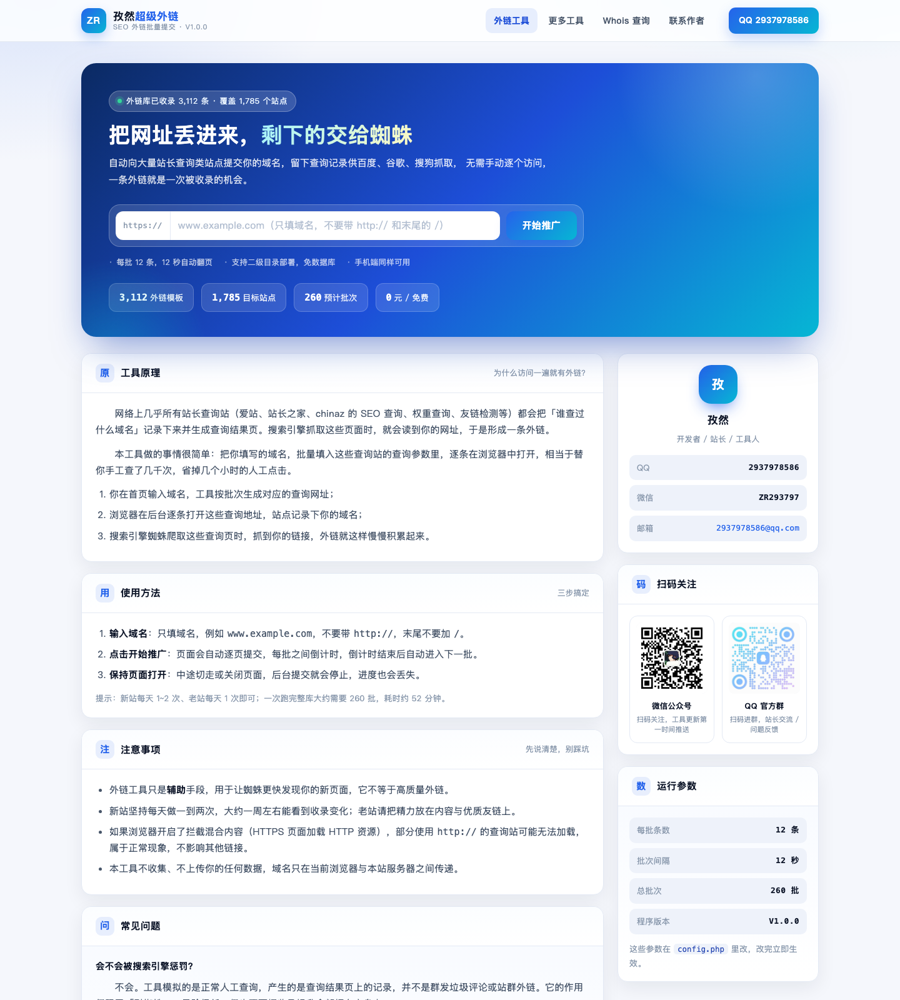
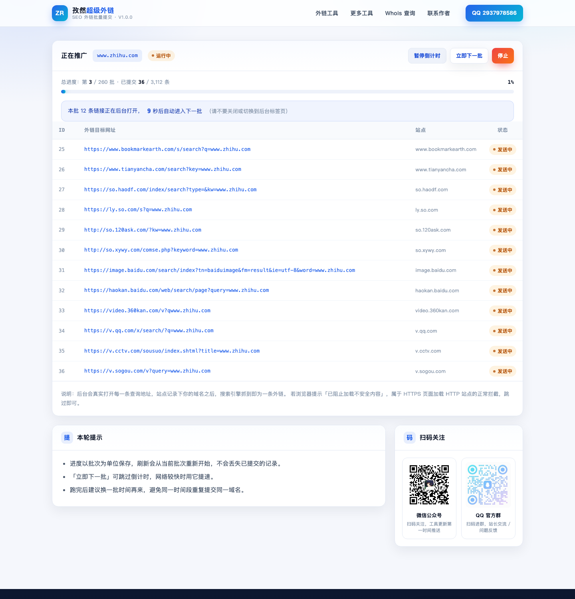
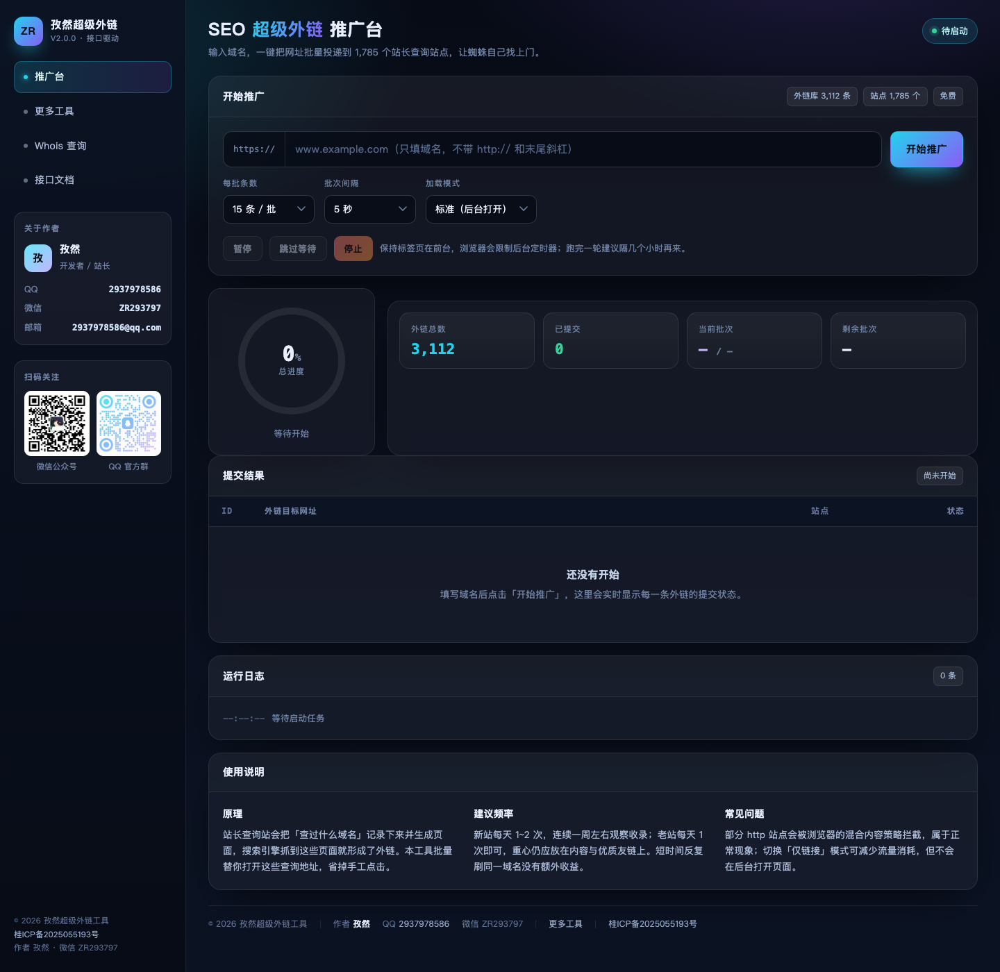

# 孜然超级外链工具（双版本）

[](LICENSE)
[](https://www.php.net/)
[](#)
[](https://github.com/2937978586/zr_seo_link)
[](https://gitee.com/qq2937978586/zr_seo_link)

基于两套原版「SEO 超级外链工具」PHP 源码重制：界面全部重写、旧版权与推广数据清理干净、外链库去重纠错、品牌统一为 **孜然**。

纯 PHP，无框架、无数据库、无 Composer 依赖，丢到任何支持 PHP 7.0+ 的主机就能跑，支持二级目录部署。

- GitHub：https://github.com/2937978586/zr_seo_link
- Gitee：https://gitee.com/qq2937978586/zr_seo_link
- 作者：**孜然**　QQ：**2937978586**　微信：**ZR293797**
- 二维码：微信公众号 + QQ 官方群（图片已放入 `images/`，替换文件即生效）





---

## 一、交付内容

| 目录 | 说明 | 适用场景 |
| --- | --- | --- |
| `V1-经典服务端版/` | 服务端渲染、整页翻页、倒计时自动下一批 | 兼容性优先，老主机 / 手机弱网也稳 |
| `V2-现代接口版/` | JSON 接口 + 前端无刷新、实时进度环、可暂停可调速 | 体验优先，单页跑完不用刷新 |
| `links.txt` | 清洗合并后的外链库（3112 条 / 1785 个站点） | 两版共用，可自行增删 |
| `scripts/clean_links.py` | 外链库清洗脚本 | 以后加新外链后重新跑一遍 |
| `dist/` | 两版打包好的 zip，可直接上传 | 一键部署 |

两版都 **不依赖数据库、不依赖框架**，只要 PHP 7.0+ 就能跑，支持放在二级目录。

## 二、界面预览

`预览图/` 里是实际运行截图：

| 文件 | 内容 |
| --- | --- |
| `01-V1首页.png` | V1 首页：渐变主视觉 + 域名输入 + 侧栏二维码 |
| `02-V1运行页.png` | V1 批量提交页：进度条、倒计时、逐条状态 |
| `03-V1完成页.png` | V1 完成页：本轮统计与再来一轮 |
| `04-V2推广台.png` | V2 推广台：控制台 + 进度环 + 统计 |
| `05-V2运行中.png` | V2 运行中：实时表格、运行日志、剩余批次 |

---

## 三、部署方法

### 1. 普通虚拟主机 / 宝塔 / 宝塔面板

1. 把 `V1-经典服务端版` 或 `V2-现代接口版` 里的**全部文件**上传到站点根目录，或二级目录（例如 `/link/`）；
2. 访问域名即可，无需安装、无需导入 SQL；
3. 确认 `links.txt` 有读取权限（644 即可），`images/` 里的二维码图片不要改名。

### 2. Nginx 用户

`.htaccess` 只对 Apache 生效。Nginx 请在站点配置里补上「禁止下载外链库」的规则：

```nginx
location ~* /(links\.txt|config\.php|\.htaccess)$ {
    deny all;
    return 404;
}
```

### 3. 本地快速预览

```bash
cd "V1-经典服务端版"      # 或 V2-现代接口版
php -S 127.0.0.1:8000
# 浏览器打开 http://127.0.0.1:8000
```

### 4. 目录结构

```
V1-经典服务端版/
├── index.php            首页（输入域名）
├── data.php             批量提交页（也支持 fmt=json 输出）
├── config.php           全站配置：站点名 / 作者 / QQ / 微信 / 二维码 / 每批条数
├── lib/common.php       公共函数（域名校验、外链库读取、分页）
├── lib/layout.php       页面骨架（顶栏 / 页脚 / 二维码卡片）
├── assets/css/style.css 样式
├── assets/js/run.js     倒计时、暂停、状态标记
├── images/qr-wechat.png 微信公众号二维码（可替换）
├── images/qr-qqgroup.png QQ 官方群二维码（可替换）
├── links.txt            外链库
├── .htaccess            禁止直接下载 links.txt / config.php
└── README.md
```

`V2-现代接口版` 结构相同，区别是：

```
V2-现代接口版/
├── index.php   推广台单页（侧栏 + 控制台 + 实时表格 + 日志）
├── api.php     JSON 接口：action=meta 取元信息，action=batch 取一批外链
├── assets/js/app.js  无刷新调度：进度环、暂停/继续/跳过/停止
```

---

## 四、改品牌 / 换二维码 / 调参数

**全部集中在 `config.php` 一个文件里**，改完立即生效，不用动模板：

```php
'author'      => '孜然',
'qq'          => '2937978586',
'wechat'      => 'ZR293797',
'email'       => '2937978586@qq.com',
'qr_wechat'   => 'images/qr-wechat.png',   // 微信公众号二维码
'qr_group'    => 'images/qr-qqgroup.png',  // QQ 官方群二维码
'page_size'   => 12,      // V1：每批条数；V2 默认 15
'page_wait'   => 12,      // V1：每批倒计时秒数；V2 默认 5
```

- **换二维码**：直接用同名文件覆盖 `images/qr-wechat.png`、`images/qr-qqgroup.png` 即可，页面会自动适配尺寸；图片缺失时显示占位块，不会破图。
- **改联系方式**：`config.php` 改完，顶栏、侧栏、页脚、详情页同步变化。
- **加外链**：往 `links.txt` 追加一行一条，占位符用 `***`（例如 `https://www.so.com/s?q=***`），然后执行：

```bash
python3 scripts/clean_links.py links.txt
```

脚本会去重、修正 `hhttp://` 这类笔误、剔除旧作者域名残留，并按站点轮询打散（相邻链接尽量不同站）。

---

## 五、两版差异对照

| 项目 | V1 经典服务端版 | V2 现代接口版 |
| --- | --- | --- |
| 提交方式 | 整页刷新，每批一次请求 | AJAX 无刷新，随时暂停/继续 |
| 分页 | 服务端 `p` 参数翻页 | 接口分批拉取 |
| 进度展示 | 顶部进度条 + 倒计时 | SVG 进度环 + 四宫格统计 |
| 控制 | 暂停倒计时 / 立即下一批 / 停止 | 暂停 / 跳过等待 / 停止 |
| 日志 | 无 | 运行日志实时输出 |
| 加载模式 | 固定后台打开 | 标准（后台打开）/ 仅链接（省流量） |
| 数据接口 | `data.php?...&fmt=json` | `api.php?action=batch` / `?action=meta` |
| 适合 | 追求稳、兼容老环境 | 追求体验、喜欢单页控制台 |

---

## 六、本次改造做了什么

### 1. 旧版权与推广数据清理

- 删除全部旧作者痕迹：`智卓星网`、`zhi66.top`、`zhiyun66.github.io`、旧统计脚本 `js.users.51.la`、校验 meta `wlhlauth`、旧 banner 图。
- 删除旧友情链接（廉价服务器 / 免费虚拟空间 / 智云 CMS / 流量卡等）与「程序更新 / 聚合榜单」等失效外链。
- 外链库里 92 条带有旧作者域名（`lusongsong.com` 等）的脏数据全部剔除。
- 统一新品牌：站点名「孜然超级外链工具」，作者信息、二维码、备案号集中到 `config.php`。

### 2. 外链库清洗（17427 行 → 3112 条）

原版 `urls.txt` 里 **14069 行是重复行**，还有 8 行缺协议、10 行把主机名写成了 `***`、1 行 `hhttp://` 笔误、13 行没有占位符。清洗后：

| 项目 | 原版 | 现在 |
| --- | --- | --- |
| 行数 | 17427（含 `new_url.txt`） | 3112 条去重结果 |
| 重复行 | 14069 | 0 |
| 无效行 | 32 | 0 |
| 站点数 | 1875（含重复协议） | 1785 |
| 同站 http/https 重复 | 大量 | 合并为 https 优先 |

并按站点轮询打散排序，避免同一批全挤在同一个站。

### 3. 修掉的原有 Bug

| 位置 | 原版问题 | 处理 |
| --- | --- | --- |
| V1 `data.php` | `$p` 未定义就参与比较、`for` 循环后多出一个 `}`，PHP 8 下直接 500 | 重写分页逻辑 |
| V1 `data.php` | 域名直接拼进 `href` 与 `iframe src`，可注入 XSS | 严格域名白名单校验 + 全量转义 |
| V1 `url.htm` | 用 `document.write` 加载任意 URL，可被当作开放跳板 | 该文件已废弃，改为按外链库生成地址 |
| V2 `data.php` | 未判断 `$_REQUEST` 是否存在、`$data` 未初始化，PHP 8 报 Warning | 重写为规范 JSON 接口 |
| V2 `data.php` | 终止条件 `if ($num > $maxpage)` 逻辑错误，可能在末尾返回空数组死循环 | 改为按「页码 > 总页数」判定 |
| V2 `index.html` | 前端 `table.cache` 判断停止、`setInterval` 未清理 | 重写状态机，暂停/停止都有明确收尾 |
| 两版 | 没有域名格式校验（V1 用超长 TLD 正则，误杀严重） | 统一 `zr_check_domain()`：协议自动剥离、路径拒绝、标签校验 |
| 两版 | 外链库、配置可被直接下载 | `.htaccess` 禁止访问 + 部署文档给出 Nginx 规则 |

### 4. 界面重写

- V1：白色卡片 + 渐变主视觉，顶栏 / 主区 / 侧栏 / 页脚四段式，移动端自动单列。
- V2：深色控制台风格，左侧导航 + 状态侧栏，右侧推广台、进度环、实时表格、运行日志。
- 两版共用一套二维码卡片组件：图片缺失时显示占位块，加载成功自动淡入。

---

## 七、使用提醒

外链工具只是辅助：新站每天 1~2 次、连续一周左右观察收录变化；老站把重心放在内容与优质友链上。跑完一轮建议隔几个小时再来，短时间反复刷同一域名没有额外收益。

---

## 八、开源协议

[MIT License](LICENSE) © 2026 孜然　QQ 2937978586　微信 ZR293797

随便用、随便改、随便商用，保留版权声明即可。改了能跑就别来问我为什么不能跑 🙂
